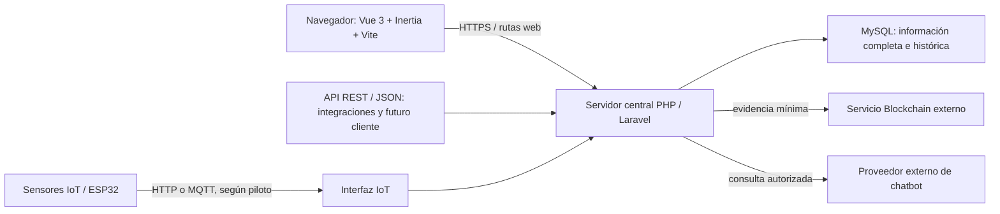

# Arquitectura web de ESPACIO-U

Fuentes: cap. II, apartados Laravel/API, Vue/Inertia, IoT, QR, Blockchain y despliegue; cap. VI, figuras 60–105; cap. VII, figuras 106–114; IS, IC y RD. Las figuras 106 y 107 corresponden a las páginas impresas 246–247 (PDF 247–248). Estado: contrato de arquitectura congelado en Fase 0.5; Fase 1 implementa únicamente la fundación web. Las capacidades funcionales del diagrama siguen planificadas.

## Componentes y límites

El esquema sintetiza el informe; no introduce microservicios, otro backend ni un cliente móvil implementado. La web usa rutas y controladores Laravel con respuestas Inertia; no necesita una API duplicada para cada interacción. La API utiliza las mismas reglas de servidor y preserva el acceso de un cliente futuro. No se permiten conexiones directas del navegador o del sensor a MySQL.

## Capas del diseño lógico

| Capa | Responsabilidad | Ubicación futura propuesta dentro de Laravel |
| --- | --- | --- |
| Presentación | Formularios, filtros, confirmaciones, estados, dashboard, QR y mensajes en español | `resources/js/Pages/`, `Components/`, `Layouts/`; respetar la convención de mayúsculas del scaffold elegido |
| Entrada web/API | Rutas, autenticación, autorización y validación de solicitudes | `routes/`, `app/Http/Controllers/`, `Requests/`, `Middleware/`, `app/Policies/` |
| Aplicación | Coordinar el CU y su transacción, sin reglas duplicadas en Vue | Controladores delgados y servicios de aplicación |
| Negocio | Disponibilidad, estados, préstamos, QR, políticas y trazabilidad | `app/Services/`, agrupados cuando el volumen lo justifique |
| Datos | Eloquent, consultas, claves, consistencia e historia | `app/Models/`, consultas junto a su responsabilidad, `database/` |
| Integraciones | Adaptadores IoT, Blockchain, chatbot y ejecución posterior a la confirmación | Servicios y contratos concretos; `config/`; jobs/eventos solo cuando su implementación esté justificada |
| Verificación | Reglas puras, comportamiento HTTP, BD real, concurrencia, fallos externos y navegador | `tests/Unit/`, `tests/Feature/` y ubicación convencional de pruebas de navegador elegida después |

Estas carpetas son propuestas de ubicación, no carpetas creadas en Fases 0/0.5. La figura 107 nombra servicios como `AuthService`, `UserManagementService`, `RolePermissionService`, `SpaceManagementService`, `ReservationService`, `QRValidationService`, `EquipmentService`, `LoanService`, `IncidentMaintenanceService`, `IoTDeviceService`, `OccupancyMonitoringService`, `ReservationReleasePolicyService`, `TraceabilityService`, `NotificationService`, `DashboardIndicatorService`, `ReportService`, `ChatbotAssistanceService` y `AuditLogService`. No obligan a generar clases vacías. `Repositories / Consultas` expresa acceso a datos; no exige envolver cada operación Eloquent en un repositorio genérico.

## Paquetes del informe

| Paquete | Casos de uso | Dependencias relevantes |
| --- | --- | --- |
| Seguridad y Administración | CU01–CU04, CU30 | Usuario, roles, permisos, sesión, registro de actividad |
| Gestión de Espacios y Reservas | CU05–CU11 | Disponibilidad, autorización, QR, políticas, auditoría |
| Gestión de Equipamiento y Préstamos | CU12–CU20 | Disponibilidad, receptor, devolución, incidencias, QR |
| Monitoreo IoT y Disponibilidad | CU21–CU23 | Sensor, evento histórico, reserva y política |
| Trazabilidad Blockchain | CU24–CU25 | Registro de actividad confirmado y evidencia local |
| Servicios de Notificación y Asistencia | CU26, CU29 | Identidad, permisos, evento confirmado; proveedor IA solo para asistencia |
| Reportes e Indicadores | CU27–CU28 | Lectura autorizada de información persistida |

QR es una responsabilidad transversal de los paquetes de espacios/equipamiento, no una nueva entidad “Módulo”. Las relaciones include/extend del informe se conservan en la matriz de CU.

## Persistencia y concurrencia

La validación del cliente mejora la interacción; la validación del servidor determina el resultado. Una solicitud debe autorizarse por acción, propietario y ámbito antes de consultar datos protegidos. Las operaciones relacionadas se confirman de manera atómica. Revalidar disponibilidad al registrar y al resolver; comprobar nuevamente el estado al entregar, devolver o liberar.

**Propuesta técnica por validar en su fase:** serializar las operaciones incompatibles sobre el recurso y reconsultar intervalos dentro de una transacción MySQL, con pruebas de dos solicitudes simultáneas y de rollback. El informe exige el resultado sin solapamientos; no prescribe un algoritmo concreto de bloqueo. Aplicar D-05: [inicio, fin), fin>inicio, reserva APROBADA y préstamos APROBADO/ENTREGADO comprometen periodos; PENDIENTE no concede exclusividad. Estado operativo, custodia y bloqueos pueden impedir disponibilidad adicionalmente. Solo plazos de cancelación/disparador de finalización siguen diferidos antes de Fase 4. No ejecutar llamadas remotas dentro de una transacción que retenga bloqueos operativos.

Una vez confirmada la operación, generar los efectos complementarios sin deshacerla por caída externa. El informe permite envío Blockchain inmediato o pendiente; la estrategia durable de recuperación, idempotencia y ejecución en varias instancias debe decidirse antes de Fase 9. No afirmar “exactly once” sin una garantía probada.

## Integraciones

| Integración | Contrato mínimo oficial | Decisiones pendientes |
| --- | --- | --- |
| IoT | Sensor registrado/habilitado, espacio, tipo de evento, valor cuando proceda y fechas; HTTP/MQTT; historial y frescura | Autenticación del dispositivo, payload, unidades, deduplicación, desfase temporal, selección de transporte y puente MQTT |
| QR | Token con hash, vigencia y objetivo; usuario y contexto de reserva/préstamo/operación; resultado con motivo | Emisión/renovación, política de uso por operación, reintentos y correlación con entrega/devolución |
| Blockchain | Hash local con algoritmo/versión canónica, operación de origen y referencia externa; privacidad previa al envío | Proveedor/red, conjunto exacto de operaciones críticas, formato canónico, reintentos y verificación |
| Chatbot | Backend con credenciales privadas, alcance por usuario y respuesta/error comprensible | Proveedor/modelo, contenido de orientación autorizado y límites de contexto; sin persistencia adicional asumida |

No se añaden contratos de proveedores imaginarios. Sustituir un proveedor no debe cambiar las reglas operativas. Los fallos se registran con datos sanitizados y se presentan sin revelar secretos.

## Interfaz y comportamiento visual

Las figuras 115–124 muestran navegación lateral, fondo claro, jerarquía visual azul, tarjetas, tablas, filtros y formularios con resumen. Son referencia visual, no datos reales para seeders ni una definición alternativa de enums. El dashboard distingue permisos; los formularios identifican campos obligatorios; errores, estados vacíos y fallos externos tienen mensajes comprensibles. La web es responsiva y usa español y fechas de Bolivia. D-14 clasifica “Recordar sesión”/“Olvidaste tu contraseña” y la entidad de conversación de análisis como NO AFECTA IMPLEMENTACIÓN: un boceto no añade esas funciones ni persistencia al contrato final.

El escaneo QR web está contemplado por la figura 121; la frontera móvil de la secuencia 111 no obliga a implementar Flutter en esta etapa. Deben probarse cámara denegada, código ilegible, contexto incorrecto y respuesta inválida.

## Despliegue futuro

Docker empaquetará Laravel y los recursos web compilados. Google Artifact Registry alojará la imagen; Cloud Run ejecutará el servicio; Cloud SQL for MySQL conservará los datos. Ninguno de estos recursos se aprovisiona en Fases 0/0.5. HTTPS es obligatorio en producción; HTTP se permite localmente según IC-01.

Antes de desplegar, decidir persistencia de sesiones y archivos, ejecución de tareas, conexión segura a Cloud SQL, secretos por entorno y coordinación de varias instancias. El informe no selecciona un broker MQTT ni una cola concretos. No alojar MySQL como almacenamiento efímero dentro del contenedor del servidor. La retención y recuperación de datos son requisitos, no promesas ya validadas.

Inventario real del equipo y puertas de preparación: [IMPLEMENTATION_PLAN.md](IMPLEMENTATION_PLAN.md). Modelo y restricciones: [DATA_MODEL.md](DATA_MODEL.md). Los puntos sin definición suficiente están en [DECISIONS.md](DECISIONS.md).

## Autoridad y límites del cierre

El diseño final del cap. VII prevalece sobre RD, luego IS/IC y el capítulo tecnológico. El cronograma histórico no redefine esta arquitectura ni selecciona tecnología (D-13). PHP/Laravel, Vue 3/Inertia/Vite y MySQL están fijados; versiones compatibles fueron seleccionadas y comprobadas en Fase 1 (D-15), según [DEVELOPMENT_SETUP.md](DEVELOPMENT_SETUP.md). No hubo instalaciones en Fase 0.5.

El servidor aplicará identificadores ASCII, estados físicos y cardinalidades de DATA_MODEL, y autorización por iniciador/flujo del CU conforme USE_CASE_MATRIX. Canonicalización exacta y envío recuperable de evidencia se cierran antes de Fase 9, manteniendo determinismo, UTF-8, campos/fechas estables, minimización y version_canonica. La operación principal se confirma en MySQL antes de seleccionar datos, canonicalizar, generar hash/evidencia local, enviar y guardar referencia; ningún fallo externo la revierte.

## Fundación técnica implementada en Fase 1

Una sola raíz Laravel. La ruta `/` entrega una respuesta Inertia `Foundation` y el mensaje técnico al componente `resources/js/Pages/Foundation.vue`. El grupo web incorpora `HandleInertiaRequests`; Blade es exclusivamente el punto de entrada HTML. Vite compila Vue y Tailwind; no hay SSR, DevTools, dashboard ni API funcional.

MySQL aislado escucha en loopback 3308, con base `espacio_u` vacía y credenciales únicamente en `.env`. Sesión/caché en archivos permiten iniciar sin tablas técnicas; en Fase 1 aún no constituían una decisión de autenticación o despliegue; la posterior Fase 1.5 define el contrato web inferior. D-16 se refleja en Laravel/PHP `America/La_Paz` y sesión MySQL `-04:00`. Las integraciones, reglas, modelos, migraciones y decisiones de fases posteriores conservan su alcance pendiente.

## Seguridad web decidida en Fase 1.5, todavía sin implementar

Autenticación nativa Laravel Session (guard web, proveedor adaptado a usuarios/correo/password_hash), con vistas Inertia/Vue del mismo origen. Sesiones técnicas file en desarrollo; sesiones_acceso es el control persistido de la sesión autenticada y no reemplaza al driver técnico. En cada solicitud protegida, validar cuenta, ID final hasheado, titular, expiración y revocación; luego evaluar autorización central. No configurar un driver database apuntando a sesiones_acceso ni añadir un almacén de tokens al navegador.

Middleware coordinará identidad/vigencia; Gates y Policies aplicarán capacidades y guardas de objetos. La resolución RBAC usa asignaciones_roles activas y roles_permisos, con permisos derivados de RF/CU y efecto de cambios en la siguiente solicitud. No bypass de Administrador, permisos confiados desde Vue ni condiciones de rol dispersas. El ámbito fino de recursos se resolverá cuando existan sus entidades, antes de exponer operaciones; su ausencia no otorga alcance global.

Contratos completos, límites de expiración/concurrencia/logout y fuentes técnicas: [D-04/D-07](DECISIONS.md#readiness-for-phase-2). API móvil, autenticación por tokens y almacenamiento distribuido siguen diferidos. Las seis tablas autorizadas para el próximo núcleo no incluyen bitácora general; no se crean adaptadores, endpoints o tablas como sustitución de ese módulo.
