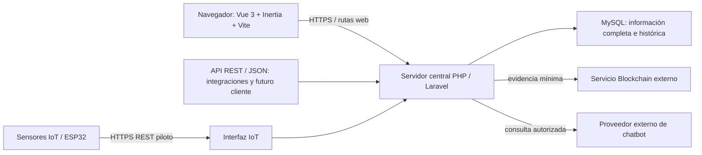
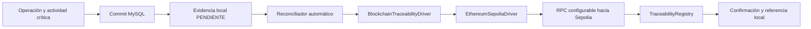
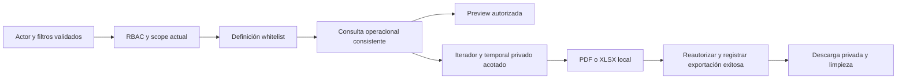

# Arquitectura web de ESPACIO-U

**Estado vigente — Fase 13 completada y validada (2026-10-26).** QA integral de CU01–CU30 y RF1–RF25 web; RF26 móvil diferido. [Informe de seguridad, rendimiento y pruebas](PHASE_13_SYSTEM_VALIDATION.md) y [matriz final por CU](FINAL_USE_CASE_VALIDATION.md). Los estados de fases anteriores que siguen son históricos. OpenAI/Sepolia pendientes independientes; excepción dev Hardhat/Zod explícita. Fase 14 NO iniciada.

**Cierre histórico — Fase 12.6 — RF25/CU30 implementados y validados localmente (2026-10-26).** [Registro de actividad y bitácora](ACTIVITY_AUDIT_IMPLEMENTATION.md): 56 acciones, recorder transaccional, permiso exclusivo de Administrador y consulta individual. Sin nuevas tablas/dependencias. Fase 13 NO iniciada; smokes OpenAI/Sepolia pendientes independientes. Los cierres siguientes conservan su alcance histórico.

**Estado histórico — Fase 12.5 documental cerrada (2026-10-26).** [Activity Audit Contract / Readiness for CU30](DECISIONS.md#activity-audit-contract--readiness-for-cu30), **0 bloqueantes documentales**. RF25 con productores parciales; CU30 **NO IMPLEMENTADO**. Implementación solo con nueva instrucción. Sin cambios de código, datos, permisos, migraciones o dependencias; OpenAI/Sepolia pendientes independientes.

**Base funcional conservada — Fase 12 implementada y validada offline (2026-10-26).** RF24/CU29: [implementación del asistente](CHATBOT_IMPLEMENTATION.md), conforme a CH1–CH12. Orientación por permisos, OpenAI Responses y contexto mínimo sin datos operativos ni historial persistido. CU30 **NO IMPLEMENTADO**; aplicación móvil diferida; ninguna fase posterior iniciada. Los cierres siguientes conservan su contexto histórico.

**Estado histórico — Fase 11.5 documental cerrada (2026-10-26).** RF24/CU29: [Chatbot Assistance Contract / Readiness for Phase 12](DECISIONS.md#chatbot-assistance-contract--readiness-for-phase-12), **0 bloqueantes documentales**. Fase 12 NO iniciada; CU30 NO IMPLEMENTADO. No cambios de código, dependencias, configuración o datos.

**Base funcional conservada — Fase 11 implementada y verificada (2026-10-26).** RF22/CU27 y RF23/CU28: 747 tests / 9111 assertions; QA y auditorías productivas aprobadas. [Implementación, scopes, formatos y evidencia](DASHBOARD_REPORTING_IMPLEMENTATION.md). Sin nuevas tablas ni índices; CU30 NO IMPLEMENTADO y Fase 12 NO iniciada. Los cierres anteriores son históricos.

**Estado histórico — Fase 10.5 documental (2026-10-26).** RF22/CU27 y RF23/CU28: [contrato de dashboard y reportes cerrado](DECISIONS.md#dashboard--reporting-contract--readiness-for-phase-11), **0 bloqueantes documentales**. Fase 11 NO iniciada; CU30 NO IMPLEMENTADO. Fase 10 funcional se conserva, sin cambios de código, datos, permisos o dependencias. Los cierres anteriores mantienen su contexto histórico.

**Estado histórico funcional — Fase 10 (2026-10-26).** RF21/CU26 implementados y verificados: 17 reglas, avisos propios, primera lectura y recuperación de 24 h. [Informe y evidencia](NOTIFICATIONS_IMPLEMENTATION.md). CU30 general y Fase 11 no iniciados. Sepolia real sigue pendiente de testETH. Los apartados de cierres anteriores conservan su contexto histórico.

**Estado histórico al cierre de Fase 9 implementada (2026-10-25/26).** RF19/CU24 y RF20/CU25, cuatro actividades críticas, dos tablas y tres permisos implementados conforme a D-12. [Implementación, pruebas offline, excepción temporal dev de Zod y Sepolia pendiente de testETH](BLOCKCHAIN_IMPLEMENTATION.md). CU30 general y Fase 10 permanecen pendientes. Las secciones de cierres anteriores conservan su contexto histórico.

**Estado al cierre funcional de Fase 8 (2026-10-24).** ReleasePolicyManagementService administra versiones/asignación; ReleaseEvaluationService ejecuta la transacción CU23; ReleaseDecision aplica la matriz; ReleaseScanService y Artisan/Scheduler coordinan lotes. HTTP/Inertia tiene proyecciones propias/administrativas. La ingestión IoT y las consultas CU22 no disparan liberación. [Informe de implementación, verificaciones y límites](RELEASE_POLICY_IMPLEMENTATION.md). Las declaraciones de fases anteriores que siguen a continuación se conservan como historia de esos cierres.

**Cierre histórico de Fase 7.5:** [D-08 resuelta para Fase 8](DECISIONS.md#readiness-for-phase-8), sin implementación nueva. El proceso futuro será Scheduler→comando→servicio CU23→transacción MySQL, con reserva coordinadora, espacio/política/sensores NOWAIT y evidencia persistida. No requiere actor humano, llegada de un evento ni consulta a un dispositivo. Los apartados anteriores/futuros se interpretan con su fecha de cierre.

**Estado histórico: Fase 7 implementada conforme a D-10.** CU21/CU22 y evidencia informativa en CU06; dos tablas IoT y tres permisos nuevos. [Implementación, seguridad, pruebas y límites](IOT_IMPLEMENTATION.md). CU23 y Fase 8 no iniciados.

La Fase 6 conserva su aceptación y su límite de corroboración física descritos en [QR_IMPLEMENTATION.md](QR_IMPLEMENTATION.md). Los cierres documentales de Fase 6.5 y anteriores se conservan como evidencia histórica; sus criterios futuros se verifican ahora en Fase 7.

Fuentes: cap. II, apartados Laravel/API, Vue/Inertia, IoT, QR, Blockchain y despliegue; cap. VI, figuras 60–105; cap. VII, figuras 106–114; IS, IC y RD. Las figuras 106 y 107 corresponden a las páginas impresas 246–247 (PDF 247–248). Estado: arquitectura contractual congelada en Fase 0.5; implementadas fundación, seguridad web, espacios y reservas hasta Fase 4. El diagrama representa también integraciones futuras que siguen pendientes.

## Componentes y límites

El esquema sintetiza el informe; no introduce microservicios, otro backend ni un cliente móvil implementado. La web usa rutas y controladores Laravel con respuestas Inertia; no necesita una API duplicada para cada interacción. La API utiliza las mismas reglas de servidor y preserva el acceso de un cliente futuro. No se permiten conexiones directas del navegador o del sensor a MySQL.

## Capas del diseño lógico

| Capa | Responsabilidad | Ubicación futura propuesta dentro de Laravel |
| --- | --- | --- |
| Presentación | Formularios, filtros, confirmaciones, estados, dashboard, QR y mensajes en español | `resources/js/Pages/`, `Components/`, `Layouts/`; respetar la convención de mayúsculas del scaffold elegido |
| Entrada web/API | Rutas, autenticación, autorización y validación de solicitudes | `routes/`, `app/Http/Controllers/`, `Requests/`, `Middleware/`, `app/Policies/` |
| Aplicación | Coordinar el CU y su transacción, sin reglas duplicadas en Vue | Controladores delgados y servicios de aplicación |
| Negocio | Disponibilidad, estados, préstamos, QR, políticas y trazabilidad | `app/Services/`, agrupados cuando el volumen lo justifique |
| Datos | Eloquent, consultas, claves, consistencia e historia | `app/Models/`, consultas junto a su responsabilidad, `database/` |
| Integraciones | Adaptadores IoT, Blockchain, chatbot y ejecución posterior a la confirmación | Servicios y contratos concretos; `config/`; jobs/eventos solo cuando su implementación esté justificada |
| Verificación | Reglas puras, comportamiento HTTP, BD real, concurrencia, fallos externos y navegador | `tests/Unit/`, `tests/Feature/` y ubicación convencional de pruebas de navegador elegida después |

Estas carpetas son propuestas de ubicación, no carpetas creadas en Fases 0/0.5. La figura 107 nombra servicios como `AuthService`, `UserManagementService`, `RolePermissionService`, `SpaceManagementService`, `ReservationService`, `QRValidationService`, `EquipmentService`, `LoanService`, `IncidentMaintenanceService`, `IoTDeviceService`, `OccupancyMonitoringService`, `ReservationReleasePolicyService`, `TraceabilityService`, `NotificationService`, `DashboardIndicatorService`, `ReportService`, `ChatbotAssistanceService` y `AuditLogService`. No obligan a generar clases vacías. `Repositories / Consultas` expresa acceso a datos; no exige envolver cada operación Eloquent en un repositorio genérico.

## Paquetes del informe

| Paquete | Casos de uso | Dependencias relevantes |
| --- | --- | --- |
| Seguridad y Administración | CU01–CU04, CU30 | Usuario, roles, permisos, sesión, registro de actividad |
| Gestión de Espacios y Reservas | CU05–CU11 | Disponibilidad, autorización, QR, políticas, auditoría |
| Gestión de Equipamiento y Préstamos | CU12–CU20 | Disponibilidad, receptor, devolución, incidencias, QR |
| Monitoreo IoT y Disponibilidad | CU21–CU23 | Sensor, evento histórico, reserva y política |
| Trazabilidad Blockchain | CU24–CU25 | Registro de actividad confirmado y evidencia local |
| Servicios de Notificación y Asistencia | CU26, CU29 | Identidad, permisos, evento confirmado; proveedor IA solo para asistencia |
| Reportes e Indicadores | CU27–CU28 | Lectura autorizada de información persistida |

QR es una responsabilidad transversal de los paquetes de espacios/equipamiento, no una nueva entidad “Módulo”. Las relaciones include/extend del informe se conservan en la matriz de CU.

## Persistencia y concurrencia

La validación del cliente mejora la interacción; la validación del servidor determina el resultado. Una solicitud debe autorizarse por acción, propietario y ámbito antes de consultar datos protegidos. Las operaciones relacionadas se confirman de manera atómica. Revalidar disponibilidad al registrar y al resolver; comprobar nuevamente el estado al entregar, devolver o liberar.

**Contrato técnico de reservas cerrado en Fase 3.5, implementado y probado en Fase 4:** serializar sobre la fila del espacio mediante SELECT FOR UPDATE, con orden compatible con la coordinación RBAC existente, lecturas actuales de conflictos y rollback completo. Dos PENDIENTE pueden coexistir; dos procesos que aprueban periodos solapados deben dejar exactamente una APROBADA y la otra PENDIENTE cuando las demás condiciones sean válidas. El informe exige el resultado sin solapamientos; no prescribe un algoritmo concreto de bloqueo. Aplicar D-05: [inicio, fin), fin>inicio, reserva APROBADA y préstamos APROBADO/ENTREGADO comprometen periodos; PENDIENTE no concede exclusividad. Estado operativo, custodia y bloqueos pueden impedir disponibilidad adicionalmente. D-05 fija cancelación estrictamente antes del inicio, con motivo opcional; FINALIZADA automática queda fuera de Fase 4. CU06/CU07/CU09 comparten SpaceAvailabilityService desde Fase 4; permanece sin cambios funcionales en Fase 4.5. [Contrato y orden de locks](DECISIONS.md#protocolo-transaccional-y-orden-de-bloqueos). No ejecutar llamadas remotas dentro de una transacción que retenga bloqueos operativos.

Una vez confirmada la operación, generar los efectos complementarios sin deshacerla por caída externa. El informe permite envío Blockchain inmediato o pendiente; la estrategia durable de recuperación, idempotencia y ejecución en varias instancias quedó cerrada en D-12/Fase 8.5, todavía sin implementación. No afirmar “exactly once” sin una garantía probada.

## Integraciones

| Integración | Contrato mínimo oficial | Decisiones pendientes |
| --- | --- | --- |
| IoT | D-10 cerrada en Fase 6.5 e implementada en 7: REST/HMAC, evento ambiental, historia, frescura y deduplicación por sensor | MQTT opcional futuro. CU22 genérico; interpretación exclusiva de CU23 cerrada documentalmente por D-08 en 7.5 |
| QR | D-09 cerrada: token/hash, ciclo, contexto y correlación atómica definidos en Fase 5.5 | Implementación Fase 6 y pruebas automatizadas disponibles; aceptación física por confirmación del usuario (sin corroboración independiente nueva); obligatoriedad global diferida |
| Blockchain | Hash local con algoritmo/versión canónica, operación de origen y referencia externa; privacidad previa al envío | D-12 cerrada en Fase 8.5; falta implementación y validación en Fase 9 |
| Chatbot | Backend con credencial privada y orientación por capacidades | Contrato CH1–CH12 cerrado en Fase 11.5: OpenAI Responses/Luna configurable, snippets locales y sin filas operativas ni persistencia de chat; implementación Fase 12 pendiente |

No se añaden contratos de proveedores imaginarios. Sustituir un proveedor no debe cambiar las reglas operativas. Los fallos se registran con datos sanitizados y se presentan sin revelar secretos.

## Interfaz y comportamiento visual

Las figuras 115–124 muestran navegación lateral, fondo claro, jerarquía visual azul, tarjetas, tablas, filtros y formularios con resumen. Son referencia visual, no datos reales para seeders ni una definición alternativa de enums. El dashboard distingue permisos; los formularios identifican campos obligatorios; errores, estados vacíos y fallos externos tienen mensajes comprensibles. La web es responsiva y usa español y fechas de Bolivia. D-14 clasifica “Recordar sesión”/“Olvidaste tu contraseña” y la entidad de conversación de análisis como NO AFECTA IMPLEMENTACIÓN: un boceto no añade esas funciones ni persistencia al contrato final.

El escaneo QR web está contemplado por la figura 121; la frontera móvil de la secuencia 111 no obliga a implementar Flutter en esta etapa. Deben probarse cámara denegada, código ilegible, contexto incorrecto y respuesta inválida.

## Despliegue futuro

Docker empaquetará Laravel y los recursos web compilados. Google Artifact Registry alojará la imagen; Cloud Run ejecutará el servicio; Cloud SQL for MySQL conservará los datos. Ninguno de estos recursos se aprovisiona en Fases 0/0.5. HTTPS es obligatorio en producción; HTTP se permite localmente según IC-01.

Antes de desplegar, decidir persistencia de sesiones y archivos, ejecución de tareas, conexión segura a Cloud SQL, secretos por entorno y coordinación de varias instancias. El informe no selecciona un broker MQTT ni una cola concretos. No alojar MySQL como almacenamiento efímero dentro del contenedor del servidor. La retención y recuperación de datos son requisitos, no promesas ya validadas.

Inventario real del equipo y puertas de preparación: [IMPLEMENTATION_PLAN.md](IMPLEMENTATION_PLAN.md). Modelo y restricciones: [DATA_MODEL.md](DATA_MODEL.md). Los puntos sin definición suficiente están en [DECISIONS.md](DECISIONS.md).

## Autoridad y límites del cierre

El diseño final del cap. VII prevalece sobre RD, luego IS/IC y el capítulo tecnológico. El cronograma histórico no redefine esta arquitectura ni selecciona tecnología (D-13). PHP/Laravel, Vue 3/Inertia/Vite y MySQL están fijados; versiones compatibles fueron seleccionadas y comprobadas en Fase 1 (D-15), según [DEVELOPMENT_SETUP.md](DEVELOPMENT_SETUP.md). No hubo instalaciones en Fase 0.5.

El servidor aplicará identificadores ASCII, estados físicos y cardinalidades de DATA_MODEL, y autorización por iniciador/flujo del CU conforme USE_CASE_MATRIX. Canonicalización exacta y envío recuperable de evidencia se cierran antes de Fase 9, manteniendo determinismo, UTF-8, campos/fechas estables, minimización y version_canonica. La operación principal se confirma en MySQL antes de seleccionar datos, canonicalizar, generar hash/evidencia local, enviar y guardar referencia; ningún fallo externo la revierte.

## Fundación técnica implementada en Fase 1

Una sola raíz Laravel. La ruta `/` entrega una respuesta Inertia `Foundation` y el mensaje técnico al componente `resources/js/Pages/Foundation.vue`. El grupo web incorpora `HandleInertiaRequests`; Blade es exclusivamente el punto de entrada HTML. Vite compila Vue y Tailwind; no hay SSR, DevTools, dashboard ni API funcional.

MySQL aislado escucha en loopback 3308, con base `espacio_u` vacía y credenciales únicamente en `.env`. Sesión/caché en archivos permiten iniciar sin tablas técnicas; en Fase 1 aún no constituían una decisión de autenticación o despliegue; la posterior Fase 1.5 define el contrato web inferior. D-16 se refleja en Laravel/PHP `America/La_Paz` y sesión MySQL `-04:00`. Las integraciones, reglas, modelos, migraciones y decisiones de fases posteriores conservan su alcance pendiente.

## Seguridad web decidida en Fase 1.5, todavía sin implementar

Autenticación nativa Laravel Session (guard web, proveedor adaptado a usuarios/correo/password_hash), con vistas Inertia/Vue del mismo origen. Sesiones técnicas file en desarrollo; sesiones_acceso es el control persistido de la sesión autenticada y no reemplaza al driver técnico. En cada solicitud protegida, validar cuenta, ID final hasheado, titular, expiración y revocación; luego evaluar autorización central. No configurar un driver database apuntando a sesiones_acceso ni añadir un almacén de tokens al navegador.

Middleware coordinará identidad/vigencia; Gates y Policies aplicarán capacidades y guardas de objetos. La resolución RBAC usa asignaciones_roles activas y roles_permisos, con permisos derivados de RF/CU y efecto de cambios en la siguiente solicitud. No bypass de Administrador, permisos confiados desde Vue ni condiciones de rol dispersas. El ámbito fino de recursos se resolverá cuando existan sus entidades, antes de exponer operaciones; su ausencia no otorga alcance global.

Contratos completos, límites de expiración/concurrencia/logout y fuentes técnicas: [D-04/D-07](DECISIONS.md#readiness-for-phase-2). API móvil, autenticación por tokens y almacenamiento distribuido siguen diferidos. Las seis tablas autorizadas para el próximo núcleo no incluyen bitácora general; no se crean adaptadores, endpoints o tablas como sustitución de ese módulo.

## Implementación posterior de Fase 2

Los apartados de Fases 1/1.5 conservan su descripción histórica. El núcleo ahora usa SessionGuard/Usuario, middleware de sesión de acceso, Gates de capacidades y servicios transaccionales. Inertia sirve Login, Inicio, Usuarios y Roles/Permisos con AppLayout compartido. El driver file y SHA-256 en sesiones_acceso cumplen funciones distintas. Dos esquemas MySQL y cuentas exclusivas separan desarrollo/testing. No hay API duplicada, módulos futuros ni bitácora general. [Diseño implementado y pruebas](SECURITY_IMPLEMENTATION.md).

## Capas implementadas de espacios — Fase 3

SpaceController/SpaceCatalogController entregan DTOs Inertia; Requests validan entradas, Gates y EspacioAcademicoPolicy reutilizan AuthorizationService. SpaceManagementService concentra transacciones, PK compartida, sincronización M:N, estado y bloqueos, con reautorización tras el bloqueo común. SpaceAvailabilityService concentra filtros y exclusión de bloqueos mediante NOT EXISTS; eager loading y paginación de 15 evitan N+1. No hay repositorio ficticio ni consulta a reservas.

La ampliación Fase 4 se incorporará en candidates para reservas activas y en su operación transaccional correspondiente. Política de liberación solo tiene tabla/modelo/relación; CU23 no existe. Alcance RBAC por módulo/acción autorizado en §35, ámbito fino diferido. [Contrato y evidencia](SPACES_IMPLEMENTATION.md).

## Materialización de reservas — Fase 4

`ReservationController` delega mutaciones a `ReservationService` y consultas con scope a `ReservationQueryService`; `ReservaPolicy` y Form Requests autorizan/validan. `SpaceAvailabilityService` comparte predicados operativos entre CU06, CU07 y CU09, con lecturas actuales transaccionales para escrituras. No se crea una API paralela, servicio alternativo de disponibilidad ni integración externa dentro de locks. [Orden de coordinación, evidencia y límites](RESERVATIONS_IMPLEMENTATION.md#disponibilidad-y-concurrencia).

## Contrato previsto de equipamiento, préstamos e incidencias — Fase 4.5

Cierre documental, sin servicios nuevos ni modificación de la aplicación. [Contrato de Fase 4.5](DECISIONS.md#contrato-de-equipamiento-y-préstamos--fase-45). La figura 112 de CU14 confirma consulta/revalidación antes de registrar solicitud; los análisis 86–93 y clases 108 conservan los límites de cada operación.

| Componente futuro | Responsabilidad |
| --- | --- |
| EquipmentService / gestión | Crear padre/subtipo atómicos, catálogo/tipos, ubicación opcional, serie única opcional y estado administrativo con permiso; no falsear custodia. |
| EquipmentAvailabilityService | Única definición de estado/filtros/periodo, préstamos APROBADO/ENTREGADO e incidencias ABIERTA; consulta CU13 y revalidación actual CU14/CU16, verificaciones pertinentes CU17. Separar lectura informativa de adquisición de locks ordenados. |
| LoanService / ciclo | Solicitar, aprobar/rechazar, entrega única y devolución/confirmación de revisión única; transiciones condicionales, responsables desde sesión y fechas servidor. Sin selector genérico de estados. |
| IncidentMaintenanceService | Recurso común espacio/equipo, reporte y cierre, enlace opcional con devolución y recuperación explícita validada. Participa en la misma transacción de retorno con anomalía, sin transacción independiente que confirme parcialmente. |
| SpaceAvailabilityService existente | En Fase 5 incorporar incidencias ABIERTA en consulta/revalidaciones CU06/CU07/CU09; preservar reservas, estados y bloqueos. Adecuar escritores CU05 a la misma guarda de recuperación. |
| AuthorizationService, Gates y Policies | Reutilizar sesión/RBAC vigente, matriz prevista de doce permisos y propiedad. No bypass, API duplicada ni asociación fina inventada. |

Orden único previsto: coordinación RBAC (fila Administrador) → subtipos por recurso_id → padres necesarios → solicitud objetivo (reserva/préstamo) → bloqueos_espacio/otras reservas/otros prestamos → entregas → devoluciones → incidencias. Relacionados por PK ascendente, excluyendo el objetivo ya bloqueado; localizar antes y revalidar relaciones después. Se conserva el orden existente de D-05: espacio, reserva objetivo y luego bloqueos/conflictos; la fila de recurso coordina también objetivos distintos. El subtipo precede al padre existente como en SpaceManagementService::save; la creación inserta padre/subtipo después de coordinación RBAC. Préstamo/hito/incidencia nunca se bloquean antes del recurso. [Protocolo completo y excepciones de filas nuevas](DECISIONS.md#transacciones-y-orden-único-de-locks).

El recurso coordinador protege también la ausencia de filas bloqueantes. Usar lecturas actuales explícitas después de esperar, no snapshot previo ni asumir que un FOR UPDATE externo afecta subconsultas. Todas las mutaciones pertinentes, incluida apertura/cierre CU19 sobre espacios, deben compartir el orden; tres reintentos acotados de deadlock, rollback total y ningún servicio externo dentro del lock. La coordinación RBAC global se conserva como limitación conocida, sin prometer paralelismo por recurso todavía.

No agregar infraestructura de eventos vacíos, tablas de bloqueo o historial alternativo. QR/CU20 se incorpora en Fase 6; el núcleo de entrega/devolución funciona sin QR. CU24/Fase 9 se conecta después del commit principal, RF21/Fase 10 y CU30 permanecen diferidos. recepcion_confirmada_en queda NULL sin endpoint adicional. La aceptación futura incluye procesos MySQL concurrentes para aprobación, entrega, devolución/revisión y recuperación frente a otra incidencia (T-P01–18). Ninguno se implementa o ejecuta en Fase 4.5.

## Implementación de equipamiento y préstamos — Fase 5

EquipmentController, LoanController e IncidentController reciben FormRequests; Policies/Gates autorizan y los servicios ejecutan las invariantes. EquipmentService crea padre/subtipo atómicamente. EquipmentAvailabilityService concentra catálogo y revalidación; LoanService maneja decisiones/hitos; LoanQueryService aplica alcance antes de filtros y presenta DTO limitados; IncidentMaintenanceService comparte recurso entre espacios y equipos. ResourceOperationService coordina transacciones, lecturas actuales y recuperación segura.

Orden común: RBAC → subtipo → préstamo objetivo → demás préstamos pertinentes → entregas → devoluciones → incidencias, por id dentro de cada grupo. Espacios conservan bloqueos/reservas antes de incidencias. La coordinación RBAC global conserva la limitación de serialización de escrituras; las pruebas incluyen espera directa del recurso para acreditar lecturas actuales. No hay llamadas externas dentro de locks. [Arquitectura aplicada, concurrencia y límites](EQUIPMENT_LOANS_IMPLEMENTATION.md#coordinación-transaccional).

## Arquitectura prevista QR — cierre de Fase 5.5

Contrato [D-09](DECISIONS.md#contrato-qr-y-validaciones--cierre-d-09-de-fase-55) resuelto, sin componentes funcionales nuevos. Cámara y decodificación local quedan en la presentación; backend propio concentra contexto, autorización, hash, vigencia y resultado. Generación/renderizado sin persistencia del token/imagen; respuesta no-store fuera de historia Inertia. No API externa ni frames subidos.

El futuro servicio de gestión QR emite/rota/desactiva con transacción sobre objetivo estable; QRValidationService comprueba y registra. CU11 solo guarda evidencia. Para CU20, un coordinador comparte la transacción y contexto bloqueado de LoanService: valida QR, ejecuta el servicio principal y enlaza la misma validación al hito; no duplica transiciones ni crea un ticket reutilizable. La pantalla reúne confirmaciones antes de leer y envía automáticamente el request al completar esa lectura explícita. No espera humana/cámara bajo lock.

Se extiende el orden existente con codigos_qr y luego validaciones_qr después de incidencias, con IDs ordenados y lecturas actuales. La integración futura deberá reutilizar el contexto ya bloqueado para no invertir el orden al volver a LoanService. INVALIDA admitida se confirma sola; VALIDA/hito/enlace/estados confirman juntos o revierten todos ante fallo técnico. Las carreras y la limitación RBAC global están documentadas en [el protocolo](DECISIONS.md#orden-de-locks-y-concurrencia-futura). No se añade almacenamiento de correlación, temporizador de negocio, cola, outbox ni tablas auxiliares.

## Implementación QR de Fase 6

QrTokenService → QrContextService → QrManagementService/QrValidationService; controladores con DTO privados, CodigoQrPolicy para CU11 y Gates de contexto. LoanService expone los mismos métodos de operación bajo transacción para ambas ramas. Locks y relecturas se extienden con QR/evidencia después de dependencias operativas. Vue usa fetch JSON efímero, Blob URL y QrScanner local; sin token en props o historial Inertia. [Arquitectura, librerías y concurrencia comprobadas](QR_IMPLEMENTATION.md). Los apartados Fase 5.5 anteriores son el contrato histórico, no el estado de implementación actual.

## Contrato de arquitectura IoT — Fase 6.5

[Protocolo normativo D-10](DECISIONS.md#contrato-iot--cierre-d-10-de-fase-65). POST /api/iot/events es entrada de dispositivos separada de Session/Inertia/CSRF web. El adaptador REST acota cuerpo y verifica HMAC RAW antes de JSON; un único servicio aplica validación ambiental, contexto, deduplicación y persistencia. MQTT futuro usa TLS/autenticación y el mismo servicio; no broker obligatorio.

Ingestión: sensor exclusivo → espacio/subtipo y recurso compartidos → primera lectura consistente para duplicado → evento → ultima_comunicacion → commit. Sin lock global Administrador ni RBAC de dispositivos. Gestión humana CU21 conserva RBAC→sensor→espacio/recurso; CU05 no adquiere sensor después de espacio. No locks durante red/UI, ni llamadas desde ingestión a servicios operativos con orden inverso. Sensores distintos, incluso del mismo espacio, tienen locks compatibles. Límites, snapshot y carreras se especifican en D-10.

La lectura actual considera fecha_evento y fecha_recepcion; UI deriva NO_DETERMINABLE y salud de comunicación, sin enums persistidos nuevos. CU06 recibe DTO informativo mínimo; SpaceAvailabilityService no usa IoT para adjudicar o liberar. CU23/Fase 8 conserva política propia; 6.5 no crea clases, rutas, colas ni configuraciones.

## Actualización de Fase 7

Entrada IoT por RawIotRequest/IotBoundary → IotEventController → IotIngestionService, con IotCredentials, IotPayload y IotRateLimiter. Gestión usa el coordinador RBAC existente y el mutex del sensor. IotMonitoringService consulta ventanas SQL e integra evidencia mínima en CU06; SpaceAvailabilityService no cambia. Vue/Inertia conserva el stack; no nuevas dependencias. [Implementación y verificación](IOT_IMPLEMENTATION.md).

## Contrato de ejecución de CU23 — Fase 7.5

Scheduler futuro cada minuto (frecuencia técnica configurable), candidatos APROBADA/inicio<=ahora/fin>ahora/política asignada, lotes por clave y servicio interno. No se evalúa dentro de la ingestión ni se espera una lectura. La reserva coordina idempotencia/estado; el protocolo [NOWAIT y snapshot posterior](DECISIONS.md#transacción-cu23-y-compatibilidad-de-locks) evita esperar espacio/sensor en orden contrario a servicios existentes. No toma el coordinador RBAC humano. Conflictos reintentan fuera de locks y fallos de lectura cierran sin liberar.

Una transacción confirma evaluación, evidencia M:N y eventual LIBERADA. La disponibilidad central interpreta el estado resultante; CU22 conserva su propia ventana y valor genérico. Las UI futuras de políticas/evaluaciones no ejecutan CU23 manualmente; Scheduler no necesita usuario Sistema. Notificaciones/Blockchain futuros ocurren fuera y después del commit cuando se autoricen. No se creó todavía comando, scheduler, clase, endpoint, cola, tabla ni configuración.

## Arquitectura de trazabilidad congelada — Fase 8.5

[Contrato D-12](DECISIONS.md#contrato-blockchain--cierre-d-12-de-fase-85). Diseño futuro: servicios de CU09/10/17/18 confirman negocio y RegistroActividad en la misma transacción; después del commit un servicio local reconstruye el documento JCS y crea EvidenciaTrazabilidad. Ninguna llamada RPC participa en esa transacción. Si la actividad falla, rollback local; si falla el procesamiento posterior, negocio confirmado y recuperación desde la actividad durable.

El scheduler futuro ejecuta trazabilidad:reconciliar cada minuto; recupera actividades sin evidencia y evidencias PENDIENTE. El callback after-commit no es la garantía durable. No se requiere tabla de cola/outbox ni payload JSON; actividad + UNIQUE local + consulta por hash + Registry idempotente garantizan un registro lógico. Exclusión por wallet en conexión MySQL dedicada coordina nonce/envío; no hay transacción ni locks de negocio durante RPC. Las consultas CU25 siguen autorización → reconstrucción/hash local → comprobación externa cuando corresponda → persistencia de última verificación.

Interfaz desacoplada de proveedor; única implementación inicial Sepolia/11155111 con guarda de red y firma. El adaptador recibe únicamente digest bytes32 para inscripción, sin objetos Eloquent/canónicos completos. Retorna resultados técnicos saneados para distinguir pendiente, confirmación y respuesta incierta. Una caída externa no cambia reservas/préstamos ni retrocede REGISTRADA. CU23/LIBERADA está excluido; QR/IoT conservan sus tablas. No se crearon ahora clases, jobs, comandos, scheduler adicional, contrato, rutas ni configuración.

## Componente implementado de trazabilidad — Fase 9

Laravel conserva la orquestación. Dos procesos Node locales breves: serializer JCS (excepción de lenguaje aprobada) y bridge ethers; no microservicio HTTP productivo. Activity + negocio se confirman juntos, evidencia local en afterCommit, RPC diferido; MySQL GET_LOCK dedicado por evidencia/wallet, sin locks de negocio durante red. Reconciliación desde actividades/evidencias cada minuto recupera dispatch perdido. Producción requiere Node y paquetes runtime de blockchain/, excluyendo Hardhat/Zod/solc y sus caches. [Diseño, recuperación, límites y verificación](BLOCKCHAIN_IMPLEMENTATION.md).

## Arquitectura prevista de RF21/CU26 — Fase 9.5

[Contrato central N1–N9](DECISIONS.md#notification-contract--readiness-for-phase-10), exclusivamente documental. Flujo futuro: servicio de negocio → transacción de negocio + registros_actividad → commit → consumidores independientes de notificación y, solo para las cuatro acciones D-12, evidencia Blockchain. No retener locks de reserva/préstamo/equipo/incidencia durante resolución de avisos ni encadenar el éxito de un consumidor al otro. El fallo de actividad local evita una operación parcial; el fallo posterior del aviso conserva la operación confirmada.

NotificationRuleRegistry centralizará las 17 reglas y ocho tipos; NotificationGenerationService recibirá actividad durable, no mensajes/destinatarios arbitrarios HTTP. Dentro de una transacción nueva bloqueará únicamente esa actividad, observará las filas existentes, resolverá los destinatarios admitidos por N6 y creará todas las faltantes como un lote atómico. La coordinación es por actividad; no mutex exclusivo global ni nueva outbox. Lecturas de permisos consistentes posteriores al lock fijan el corte de elegibilidad sin mantener locks de recursos.

El comando interno futuro notificaciones:reconciliar usará ese mismo servicio, cada minuto configurable y lotes de 100: ventana de 24 h desde evento y corte de habilitación RF21 estable. Sin filas recalcula actuales; con cualquier fila no amplía administrativos y solo repara directos reconstruibles faltantes. Un crash no deja medio lote; pérdida externa de administrativos de un lote confirmado no es reconstruible con el SQL actual. N6 define estos límites y evita redistribuir historia por cambios posteriores de permisos.

El detector de vencimientos es un productor separado: revalida ENTREGADO/fin_previsto y actividad previa bajo lock de préstamo, inserta una actividad como máximo y despacha tras commit; no modifica estado ni toma equipo/RBAC después de préstamo. CU23 mantiene su orden/NOWAIT e idempotencia, incorporando actividad al mismo commit de evaluación ALERTAR/LIBERAR.

HTTP/Inertia futuro: consultas limitadas al propietario y permiso notificaciones.ver_propias; DTO de notificación sin serializar actividad ni motivos libres. Lista/contador mediante consultas paginadas; GET sin efectos. Tras abrir detalle, POST/PATCH con CSRF registra primera lectura. Los enlaces a negocio se calculan/autorizan en servidor. Navegación Inertia normal, sin WebSockets/Reverb/Pusher/polling agresivo. No infraestructura de mensajería externa, CU30 general ni tablas auxiliares. No se crean aquí clases, jobs, rutas, vistas ni configuración.

## Componente de notificaciones implementado — Fase 10

Actividad EXITO dentro de negocio, callback afterCommit/deferred, Registry y GenerationService con lock por actividad y snapshot posterior. Lote atómico, Reconciler 24 h y CU26 propio. Consumidor independiente de Blockchain. [Implementación y evidencia](NOTIFICATIONS_IMPLEMENTATION.md).

## Arquitectura prevista de dashboard y reportes — Fase 10.5

[DR1–DR12](DECISIONS.md#dashboard--reporting-contract--readiness-for-phase-11) fija responsabilidades para Fase 11; no existen nuevos componentes implementados por este cierre. Backend MySQL autoritativo, sin persistencia analítica ni cache compleja inicial. DashboardService coordina queries agregadas especializadas y scopes por actor; Vue presenta los resultados. Reutilizar SpaceAvailabilityService, IotMonitoringService, NotificationReadService y consultas autorizadas de dominios; no repetir sus reglas en gráficos/reportes.

ReportRegistry contiene siete ReportDefinition whitelist; cada definición concentra filtros tipados, fecha de referencia, autorización/scope, columnas y orden. ReportQueryService la consume para preview paginada e iteración de exportación. ReportExportService renderiza localmente PDF/XLSX, gestiona límites y temporales, reautoriza y registra el éxito no crítico. Controladores delgados; formatos no construyen SQL ni aceptan filas del navegador. No se instalan librerías hasta evaluar compatibilidad PHP 8.5/Laravel/Vue, mantenimiento, licencia, auditoría, memoria y bundle.

El flujo conceptual no crea endpoints ahora. Preview y exportación son peticiones separadas con cortes visibles; cada una comparte semántica y un snapshot interno coherente. Cerrar lectura antes de renderizado prolongado; reautorizar fuera del snapshot antes de respuesta. No locks de escritura durante generación. REPORTE_EXPORTADO se registra después de completar el archivo y antes de ponerlo a disposición; fallo de inserción impide descarga. Ninguna dependencia de Blockchain/avisos, ninguna ruta de bitácora CU30.

Actualización por carga/filtros/navegación o botón, sin WebSocket/polling agresivo. Consultas agregadas y exportación por lotes/iteradores; 10.000 filas, 30 s y 64 MiB son límites técnicos iniciales configurables del contrato, pendientes de medición. Objetivo dashboard <=5 s. Temporales privados y eliminación también ante error/desconexión/huérfanos; sin URL pública ni archivos persistidos por defecto.

## Arquitectura ejecutada de Fase 11

DashboardService agrega en MySQL, delega IoT/notificaciones y conserva scopes de reservas/préstamos. ReportRegistry fija siete ReportDefinition; Request/ReportFilters validan whitelist; QueryService aplica autorización/proyección/orden común. GenerationService coordina snapshot privado, renderizado y revalidación; ExportService solo formato, writers locales; AuditService registra salida no crítica. Temporales privados con lease y cleanup cada minuto. [Detalle y límites](DASHBOARD_REPORTING_IMPLEMENTATION.md). No BI/cache/tabla nueva ni cálculo crítico Vue.

## Arquitectura prevista de asistencia — Fase 11.5

[Contrato vinculante CH1–CH12](DECISIONS.md#chatbot-assistance-contract--readiness-for-phase-12). Flujo previsto: Vue/Inertia → endpoint web Laravel → autorización/validación/rate limit → ChatbotService → ChatbotKnowledgeBase/ChatbotRouteRegistry → ChatbotProvider → OpenAIChatbotProvider por HTTPS. La respuesta atraviesa validación estricta y reautorización antes del texto plano y enlace local. FakeChatbotProvider y fake HTTP permiten pruebas sin Internet. Ningún componente se crea en este cierre.

ChatbotProvider intercambia DTO propios (instrucciones específicas, pregunta actual, capacidades relevantes y snippets; salida status/answer/route_key), no modelos Eloquent ni objetos del SDK. Solo autorización lee cuenta/sesión/roles/permisos; no dependencia de servicios que consulten registros operativos o ejecuten negocio. Adaptador inicial preferido: HTTP Client Laravel existente, sujeto a revisar SDK/documentación antes de instalar nada. No frontend→OpenAI, tools, llamadas SQL del modelo ni proveedor secundario automático.

GET /asistente y POST /asistente/consultar son rutas futuras, con auth/access.session/chatbot.consultar/CSRF. POST JSON sin echo/flash del input, página Inertia sin mensajes en props. No streaming, history remember, conversaciones remotas, tablas, colas con prompts, cache de respuestas ni embedding store. Plazo monotónico único de 15 s, como máximo dos intentos dentro de él; nunca locks operativos o de sesión durante red. Rate limit atómico por usuario en store existente, separado de operaciones principales. Fallo del proveedor retorna aviso y no interrumpe otros módulos. Detalle de validación, memoria efímera y límites en CH8–CH10.

## Asistencia implementada — Fase 12

RF24/CU29 se materializa mediante ChatbotRequest/Boundary/RateLimit → ChatbotService → ChatbotKnowledgeBase/ChatbotProvider → validador/ChatbotRouteRegistry → página Asistente. OpenAIChatbotProvider usa Laravel HTTP Client/Responses y FakeChatbotProvider queda inyectado en pruebas. Sin dependencia nueva ni consulta a entidades operativas; solo autenticación/sesión/autorización existentes. Contexto procedimental separado del mensaje no confiable, schema estricto, deadline conjunto y salida reautorizada. [Detalle, privacidad y evidencia](CHATBOT_IMPLEMENTATION.md). Sin nueva entidad de conversación, caché de conocimiento, tools, colas, streaming o infraestructura BI. CU30 sigue diferido.

## Arquitectura prevista de auditoría — Fase 12.5

[Activity Audit Contract / Readiness for CU30](DECISIONS.md#activity-audit-contract--readiness-for-cu30), AC11–AC14: ActivityRecorder central futuro para inserción/plantillas/contexto, ActivityQueryService para consulta individual, Form Request y controlador delgado; Vue presenta DTO autorizado. No crear estas piezas en esta fase documental. Servicios existentes CriticalActivityRecorder, NotificationActivityRecorder y ReportAuditService se adaptarán sin segunda fila ni cambio de semántica. No observer genérico que infiera actor o duplique estados internos.

EXITO obligatorio dentro de transacción de negocio; fallo de registro revierte; callbacks Blockchain/notificaciones después del commit y por whitelists vigentes. RECHAZO/ERROR selectivos AC6 en transacción nueva tras rollback confirmado, sin recursión ni falsear commit incierto. Conservar locks/retries de dominio y reglas por operación AC12; no garantía de deduplicación de requests independientes. Consulta paginada SQL con filtros whitelist y referencias reautorizadas. RF23 conserva query agregada distinta; ninguna ruta de CU30 existe todavía.

## Implementación RF25/CU30 — Fase 12.6

ActivityRecorder centraliza una inserción por hito; ActivityAttempt/ActivityTransaction gestionan intentos después de rollback confirmado. CriticalActivityRecorder/NotificationActivityRecorder/ReportAuditService delegan sin duplicación. ActivityFilters/ActivityQueryService proyectan CU30; controlador delgado y Vue de solo lectura. Catálogos mutan desde SpaceManagementService.saveCatalog. No observer genérico, servicio externo, tabla o dependencia nueva. [Implementación, evidencia y límites](ACTIVITY_AUDIT_IMPLEMENTATION.md).

## Revalidación integral — Fase 13

PrivateResponse se ejecuta como middleware exterior, incluidos routing, /up e IoT. Boundaries específicos mantienen prioridad. Reporter general solo clase y huella de ubicación; 500 con debug=false tiene cuerpo fijo. CORS API explícito sin orígenes de navegador. UI comparte keepDialogFocus en tres diálogos y bloquea filtros de dashboard/reportes mientras espera respuesta. Sin nueva infraestructura, tablas ni dependencias.
