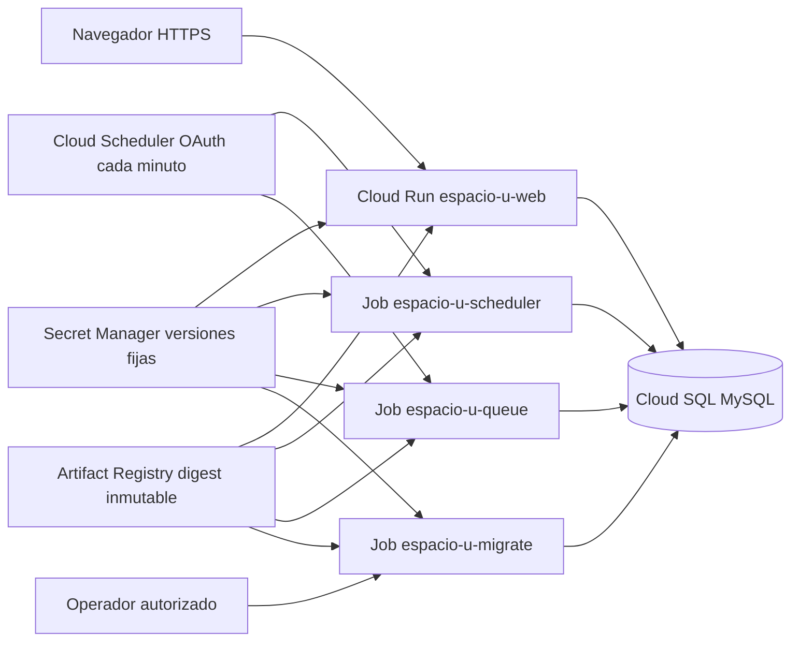

# Arquitectura preparada para Google Cloud

**No hay recursos cloud creados ni despliegue realizado en Fase 14.** Topología inicial para un piloto autorizado, no certificación de disponibilidad productiva.

## Región y datos

Región configurable, inicial `southamerica-west1`; Cloud Run, Cloud SQL y Artifact Registry se preparan en la misma región. Confirmar disponibilidad/coste/cuotas con el proyecto aprobado antes de crear recursos. MySQL **MYSQL_8_4**, validado localmente con 8.4.11; Google administra menores compatibles. No downgrade del MySQL de desarrollo ni relajación de CHECK/SQL modes. 31 tablas académicas, 211 columnas, 63 FK y ocho RESTRICT previamente aprobados intactos. Cuatro tablas framework adicionales, más migrations.

Cloud SQL Enterprise inicial ZONAL, db-custom-1-3840, SSD 20 GB, auto-crecimiento con tope 100 GB, max_connections 200 propuesto, backups/PITR. No atribuir alta disponibilidad regional a esta opción piloto; para comprometer SLA se requiere presupuesto/decisión HA y medición. Los importes y cuotas deben consultarse al autorizar.

Conexión nativa mediante `/cloudsql/PROJECT:REGION:INSTANCE` y `DB_SOCKET`. Cloud Run gen2 y roles/cloudsql.client; no proxy daemon empaquetado, no conexión directa por IP pública ni lista 0.0.0.0/0. El plan exige connector-enforcement REQUIRED y deja authorized networks vacías. El endpoint público gestionado de SQL puede sostener el conector autenticado; no equivale a abrir MySQL al público. IP privada/VPC puede evaluarse después, no se introduce conector VPC sin necesidad. [Conexión oficial](https://docs.cloud.google.com/sql/docs/mysql/connect-run), [versiones MySQL](https://docs.cloud.google.com/sql/docs/mysql/db-versions).

## Web y presupuesto de recursos

| Ajuste inicial | Valor |
| --- | --- |
| CPU / memoria | 1 vCPU / 1 GiB |
| Concurrencia Cloud Run | 20 solicitudes por instancia |
| Mínimo / máximo | 0 / 3 instancias por revisión |
| Timeout request | 60 s; PHP 55 s; reportes 30 s; chatbot 15 s |
| Apache prefork | 8 workers, 2 iniciales, reciclado a 500 conexiones |
| PHP memory_limit / OPcache | 96 MiB por request / 128 MiB compartidos |
| Health | /up; startup 5 s × 24, liveness 30 s × 3 |

20 × 3 = 60 requests admitidos, hasta 24 workers PHP activos; el resto espera. DB típica una conexión por worker; cota conservadora 3 por actividad que use locks de evidencia/wallet: 72 conexiones. Durante solapamiento de dos revisiones puede duplicarse a 144. Reservar hasta 18 para ejecuciones de jobs que se solapen, una migración y diez de operación: 173 < 200, margen 27. Es presupuesto inicial, no prueba de saturación ni límite duro global: controlar número de revisiones/triggers, monitorizar conexiones y reducir máximos si la medición exige. No dejar instancias ilimitadas ni usar pool persistente PDO.

El filesystem escribible del contenedor es efímero y consume recursos. PDF/ZIP/temporales cuentan en memoria; límite de exportación vigente 64 MiB, 10.000 filas y 30 s. No asumir ocho PDF máximos simultáneos sin medir; la prueba local y F13 orientan el piloto. Min=0 admite cold starts.

**CPU asignada durante la vida de la instancia** (`cpu-throttling=false`) permite limpiar temporales incluso sin nuevas requests; no implica min=1. Tiene coste de CPU durante periodos ociosos de instancias vivas y debe presupuestarse. Cloud Run puede terminar instancias inactivas; su filesystem desaparece. No usar un job separado para intentar borrar disco de otra instancia. El janitor por instancia corre cada 30 s, respeta leases y el TTL ≤1 h; SIGTERM recoge procesos. [CPU y facturación](https://docs.cloud.google.com/run/docs/configuring/services/cpu), [contrato de contenedor](https://docs.cloud.google.com/run/docs/container-contract).

## HTTPS y sesiones

Cloud Run termina TLS. `TrustDeploymentProxies` interpreta FOR/PROTO/PORT exclusivamente cuando target=cloud-run y antes del boundary IoT. No confía en X-Forwarded-Host ni activa confianza por nombre Host. La URL canónica HTTPS y cookie Secure son obligatorias en ese target. El contenedor no se publica directamente fuera del ingreso gestionado. Local no confía en forwarded headers. HSTS solo producción HTTPS y excluye localhost/loopbacks; CSP/frame/nosniff/referrer/no-store se mantienen.

Todas las réplicas usan el mismo APP_KEY y DB; no regenerar key por instancia/deploy. Sesiones y locks viven en MySQL. Cambio de permisos, usuario INACTIVO, revocación y logout se observan desde la otra réplica. Logs Laravel stderr con metadata segura; acceso Apache método/status/duración, sin URL/query/cookies/cuerpos. No general query log ni debug en producción.

## Jobs e identidades

| Identidad dedicada | Permisos previstos |
| --- | --- |
| espacio-u-web | cloudsql.client; secretAccessor solo APP_KEY, DB runtime, IOT master |
| espacio-u-jobs | cloudsql.client; secretAccessor solo APP_KEY y DB runtime; integraciones externas desactivadas |
| espacio-u-migrate | cloudsql.client; secretAccessor solo APP_KEY y DB migración |
| espacio-u-scheduler | run.invoker exclusivamente sobre scheduler/queue jobs; sin secretos ni SQL |
| espacio-u-build | artifactregistry.writer solo repositorio; logging.logWriter si Cloud Build opcional |
| Operador de despliegue | permisos de despliegue y actAs sobre identidades concretas; asignación temporal revisada |

No Owner/Editor a runtime, JSON keys ni roles IAM de administración cloud a web. IAM no sustituye grants MySQL: cuenta runtime SELECT/INSERT/UPDATE/DELETE; migración añade CREATE/ALTER/DROP/INDEX/REFERENCES solo en espacio_u. Crear cuentas por canal administrativo privado y revisar grants efectivos; plantilla `database-grants.sql`. Las credenciales DDL nunca entran a web.

`espacio-u-migrate`: migrate --force, misma imagen, una tarea, retries 0, timeout 600 s, antes de mover tráfico. `espacio-u-scheduler`: schedule:run, tarea única, retries 0, timeout 180 s. `espacio-u-queue`: worker acotado, tarea única, retries 0 a nivel ejecución; reserva/reintentos de trabajos en MySQL. Triggers cada minuto, America/La_Paz, OAuth hacia API Jobs; no endpoint HTTP de negocio para cron. Scheduler puede invocar más de una ejecución: locks y reglas idempotentes se revalidaron entre contenedores. [Procedimiento oficial](https://docs.cloud.google.com/run/docs/execute/jobs-on-schedule).

## Secretos y configuración

| Secreto | Uso / rotación |
| --- | --- |
| APP_KEY | Una versión compartida web/jobs; rotación coordinada, invalidar sesiones y revisar cualquier dato cifrado antes de retirar versión previa |
| DB runtime password | Versión explícita en web/jobs; transición controlada de contraseña/usuarios, validar nueva revisión y retirar antigua |
| DB migration password | Solo job migrate; rotación independiente y acceso temporal |
| IOT_MASTER_SECRET | 64 hex, solo web antes de habilitar sensores; rotación invalida derivadas, requiere reprovisionar sensores en ventana controlada |
| OPENAI_API_KEY, opcional | Solo cuando se autorice activación y exista cuota; no requerida con chatbot disabled |
| Blockchain RPC/private key, opcionales | Secretos separados, solo productor externo autorizado; revisar wallet/contrato, no fondos reales |
| Administrador inicial | Correo/contraseña temporales solo job bootstrap de una ejecución; retirar acceso/versión y job al completar |

Env Secret Manager se resuelve al iniciar instancia: fijar **versión numérica**, no latest; tras rotación publicar nueva revisión/job y retirar vieja cuando no se necesite rollback. [.env.docker.example](../.env.docker.example) sirve solo para local, nunca se sube .env.docker. Config cloud solo nombres/versiones; aplicación no llama Secret Manager directamente. [Secretos Cloud Run](https://docs.cloud.google.com/run/docs/configuring/services/secrets).

NOTIFICATIONS_EVENTS_FROM no es secreto: fecha de activación local La Paz estable, obligatoria; no moverla hacia atrás en redeploy. Session lifetime, límites de reportes, rate limits, release schedule y demás contratos conservan defaults; cambios requieren medición y revisión. Providers externos permanecen false en plantillas iniciales. No habilitar por el mero hecho de tener una variable de entorno.
