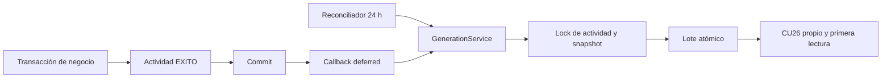

# Implementación de notificaciones internas — Fase 10

**Estado vigente — Fase 10.5 documental (2026-10-26).** RF22/CU27 y RF23/CU28: [contrato de dashboard y reportes cerrado](DECISIONS.md#dashboard--reporting-contract--readiness-for-phase-11), **0 bloqueantes documentales**. Fase 11 NO iniciada; CU30 NO IMPLEMENTADO. Fase 10 funcional se conserva, sin cambios de código, datos, permisos o dependencias. Los cierres anteriores mantienen su contexto histórico.

Fecha: 2026-10-26. RF21/CU26 implementados en el workspace oficial. Contrato vinculante: [N1–N9](DECISIONS.md#notification-contract--readiness-for-phase-10). No se reabren D-04/D-08/D-12 ni se implementan CU30, CU27, CU28 o Fase 11.

## Esquema, dominio y permiso

Una migración incremental, `2026_10_26_000031_create_notificaciones_table.php`, materializa las ocho columnas oficiales: id, destinatario_id, registro_actividad_id, titulo VARCHAR(160), mensaje TEXT, tipo ENUM, creada_en DATETIME DEFAULT CURRENT_TIMESTAMP y leida_en DATETIME NULL. Conserva las dos FK con ON UPDATE CASCADE / ON DELETE RESTRICT y los índices idx_notificacion_destinatario(destinatario_id, leida_en) e idx_notificacion_fecha(creada_en). Sin UNIQUE adicional, JSON, outbox, timestamps automáticos ni soft delete. Las migraciones anteriores no se modifican. Total académico: **31 tablas, 211 columnas y 63 FK**; migrations es técnica.

`Notificacion` conserva snapshots inmutables; la única mutación funcional es la primera lectura. `TipoNotificacion` contiene SOLICITUD, DECISION, CANCELACION, ENTREGA, DEVOLUCION, VENCIMIENTO, INCIDENCIA y LIBERACION. El seeder añade únicamente `notificaciones.ver_propias` para los cuatro roles. Catálogo total: 47 permisos; asignaciones por rol: 43/29/10/10. La recepción de un aviso no exige CU26; la consulta sí.

| Operación | Administrador | Encargado | Docente | Estudiante |
| --- | --- | --- | --- | --- |
| Listar, contar, abrir y leer propios | Sí | Sí | Sí | Sí |
| Consultar avisos ajenos | No | No | No | No |
| Recibir como administrativo | Permisos efectivos AR/AP/AD/AI/AL | Elegibilidad D-04 y permisos efectivos | Sin ampliar D-04 | Sin ampliar D-04 |
| Recibir como titular S | Si corresponde | Si corresponde | Si corresponde | Si corresponde |

## Arquitectura y fuente de eventos

El único origen es una actividad confirmada EXITO incluida en NotificationRuleRegistry. Un rechazo de negocio correctamente ejecutado es EXITO; ERROR, rechazos técnicos, eventos QR/IoT aislados y técnicos Blockchain no generan avisos. NotificationContext valida familia, responsable humano/proceso, crítica, titular y correlación; no reinterpreta el estado actual como si fuera el hito histórico.

Los productores llaman NotificationActivityRecorder dentro de la transacción de negocio. CU23 registra evaluación, transición cuando corresponde, pivotes y actividad atómicamente. Se reutilizan las cuatro actividades críticas existentes: RESERVA_APROBADA, RESERVA_CANCELADA, PRESTAMO_ENTREGADO y PRESTAMO_DEVUELTO. CriticalActivityRecorder, builders, hashes, contrato y módulo blockchain/ permanecen sin cambios funcionales. Las otras trece actividades son no críticas.

RegistroActividad registra un callback afterCommit; NotificationDispatch envía GenerateNotifications por conexión deferred. Se ejecuta después de respuesta/commit y captura fallos con diagnóstico por ID. El generador exige una transacción nueva sin snapshot previo. Blockchain y avisos son consumidores independientes: ninguno requiere éxito del otro, RPC, fondos ni estado REGISTRADA. Si falla despacho o termina el proceso, la actividad durable permite recuperación acotada.

## Las 17 reglas y plantillas

S es usuario_afectado_id; AR exige reservas.resolver + reservas.ver_administrativas; AP exige prestamos.resolver + prestamos.ver_administrativos; AD exige prestamos.registrar_devolucion + prestamos.ver_administrativos; AI exige incidencias.ver; AL exige liberacion.evaluaciones.ver_administrativas. Cada permiso aplica elegibilidad D-04, asignación no retirada y cuenta ACTIVO. El nombre del rol no basta.

Cancelación propia avisa AR sin titular; cancelación por otro responsable avisa solo S. S_AI incluye S únicamente con vínculo real incidencia → devolución → préstamo; no se inventa titular manual. Grupos administrativos excluyen actor. Unión deduplicada; prevalece plantilla S incluso si también pertenece al grupo. S no se excluye por ser actor salvo autocancelación.

La tabla reproduce constantes implementadas. Cada mensaje añade `Evento registrado: {fecha_evento} (America/La_Paz).`, fecha del evento y no de recuperación.

| Acción | Tipo | Destinatarios | Título | Mensaje S | Mensaje administrativo |
| --- | --- | --- | --- | --- | --- |
| RESERVA_SOLICITADA | SOLICITUD | AR | Nueva solicitud de reserva | — | La solicitud de reserva {reserva} fue registrada y requiere resolución. |
| RESERVA_APROBADA | DECISION | S | Reserva aprobada | Tu solicitud de reserva {reserva} fue aprobada. | — |
| RESERVA_RECHAZADA | DECISION | S | Reserva rechazada | Tu solicitud de reserva {reserva} fue rechazada. Consulta el detalle autorizado para más información. | — |
| RESERVA_CANCELADA | CANCELACION | CANCELACION | Reserva cancelada | Tu reserva {reserva} fue cancelada por un responsable autorizado. | El titular canceló la reserva {reserva}. |
| PRESTAMO_SOLICITADO | SOLICITUD | AP | Nueva solicitud de préstamo | — | La solicitud de préstamo {prestamo} fue registrada y requiere resolución. |
| PRESTAMO_APROBADO | DECISION | S | Préstamo aprobado | Tu solicitud de préstamo {prestamo} fue aprobada. | — |
| PRESTAMO_RECHAZADO | DECISION | S | Préstamo rechazado | Tu solicitud de préstamo {prestamo} fue rechazada. Consulta el detalle autorizado para más información. | — |
| PRESTAMO_ENTREGADO | ENTREGA | S | Equipamiento entregado | Se confirmó la entrega del equipamiento de tu préstamo {prestamo}. | — |
| DEVOLUCION_PENDIENTE_REVISION | DEVOLUCION | AD | Devolución pendiente de revisión | — | La recepción del préstamo {prestamo} quedó pendiente de revisión de su condición física. |
| PRESTAMO_DEVUELTO | DEVOLUCION | S | Devolución confirmada | Se confirmó la devolución de tu préstamo {prestamo}. | — |
| PRESTAMO_VENCIDO | VENCIMIENTO | S_AD | Préstamo vencido | Tu préstamo {prestamo} fue detectado como vencido. | El préstamo {prestamo} fue detectado como vencido y requiere seguimiento. |
| INCIDENCIA_REGISTRADA | INCIDENCIA | S_AI | Incidencia registrada | El equipamiento de tu préstamo {prestamo} requiere revisión; se registró una incidencia. | Se registró la incidencia #{incidencia}; consulta el detalle autorizado. |
| INCIDENCIA_CERRADA | INCIDENCIA | S_AI | Incidencia cerrada | Se cerró la incidencia vinculada a la devolución de tu préstamo {prestamo}. | Se cerró la incidencia #{incidencia}. |
| MANTENIMIENTO_REGISTRADO | INCIDENCIA | S_AI | Mantenimiento registrado | El equipamiento de tu préstamo {prestamo} requiere revisión; se registró mantenimiento. | Se registró el mantenimiento #{incidencia}. |
| MANTENIMIENTO_CERRADO | INCIDENCIA | S_AI | Mantenimiento cerrado | Se cerró el mantenimiento vinculado a la devolución de tu préstamo {prestamo}. | Se cerró el mantenimiento #{incidencia}. |
| RESERVA_ALERTADA_LIBERACION | LIBERACION | S_AL | Reserva requiere atención | Se detectó posible no utilización de tu reserva {reserva}; requiere atención. Esta alerta no liberó la reserva. | La reserva {reserva} presenta posible no utilización; requiere atención. Esta alerta no liberó la reserva. |
| RESERVA_LIBERADA | LIBERACION | S_AL | Reserva liberada | Tu reserva {reserva} fue liberada conforme a la política aplicable. | La reserva {reserva} fue liberada conforme a la política aplicable. |

Solo se interpolan código estable de reserva/préstamo, ID de incidencia y fecha. No motivo, propósito, condición, solución, nombre libre de recurso, correo, CI, terceros, QR, HMAC, RPC o claves. Vue renderiza texto; DTO mínimo sin RegistroActividad completo. Snapshot no cambia tras cancelación, devolución, lectura, reintento o permisos.

## Generación, idempotencia y concurrencia

NotificationGenerationService toma SELECT FOR UPDATE solo sobre actividad. Después de esperar captura hora vigente y hace su **primera lectura consistente** de avisos existentes. Contexto y destinatarios comparten snapshot MySQL. Sin mutex global, locks de huecos ni locks de usuarios, roles, permisos o negocio.

Clave lógica: actividad + destinatario + tipo. Exclusión por actividad, lectura de filas confirmadas y escritor central evitan duplicados. Inserciones por sentencias de 100 dentro de una sola transacción: matar proceso entre sentencias revierte todo. Actividades distintas progresan con receptores compartidos. Timeout/deadlock 1205/1213 reintenta hasta tres veces; agotamiento deja recuperación pendiente sin rollback de negocio.

No se añade UNIQUE porque el SQL lo prohíbe. La garantía depende de que las escrituras funcionales atraviesen el protocolo; SQL externo no está protegido por una UNIQUE inexistente. Factories solo para fixtures.

## Reconciliación y límites de recuperación

`notificaciones:reconciliar` selecciona EXITO + allowlist en lotes de 100 y llama al mismo generador. Ventana inclusiva: evento <= ahora <= evento + 24 h, evento >= NOTIFICATIONS_EVENTS_FROM. Corte explícito estable de despliegue en America/La_Paz; reiniciar no recalcula. Configuración ausente/inválida, evento futuro, anterior al corte o vencido: no genera. Sin backfill.

- Ninguna fila: S y administrativos actuales elegibles. Cero receptores deja cero filas, sin marcador ficticio; puede reevaluar dentro de ventana.
- Cualquier fila existente: administrativos cerrados. Solo repara S reconstruible, ACTIVO y faltante; conserva texto/creada_en/leida_en.
- **No puede reconstruirse el conjunto administrativo histórico perdido tras confirmar un lote.** No existe snapshot de receptores en SQL. Nuevos permisos no amplían el lote; no se promete reparación administrativa completa.
- Revocación/desactivación confirmada antes del snapshot excluye; después conserva el corte. La siguiente petición de lectura revalida permiso/estado.

Scheduler ejecuta reconciliación y detector cada minuto por defecto, cron configurable y withoutOverlapping(10). Locks de actividad/préstamo garantizan integridad también frente a ejecución manual concurrente.

## Vencimientos, incidencias y CU23

`prestamos:detectar-vencimientos` usa OverdueLoanService: lock de préstamo, relectura ENTREGADO y ahora estrictamente mayor que fin_previsto, búsqueda de actividad previa y una PRESTAMO_VENCIDO. Igualdad no vence. Sin estado VENCIDO ni cambio de custodia. Devolución/detector serializan ambos órdenes; recuperación conserva hito aunque ya se haya devuelto.

PENDIENTE_REVISION produce una actividad no crítica y AD una vez; préstamo sigue ENTREGADO. Confirmación posterior reutiliza PRESTAMO_DEVUELTO crítico. Incidencia/mantenimiento abierto/cerrado produce acción específica, tipo INCIDENCIA. Devolución con incidencia confirma actividades juntas; S recibe mensaje neutral sin culpa. Cerrar no promete disponibilidad si hay otras restricciones.

CU23 ALERTAR produce RESERVA_ALERTADA_LIBERACION y dice que no liberó. LIBERAR produce RESERVA_LIBERADA solo junto con APROBADA → LIBERADA y evaluación confirmadas. MANTENER_POR_USO y NO_DETERMINABLE no generan RF21. Descripcion exacta `Evaluación CU23 #{evaluacion_id}; política #{politica_id}.` correlaciona sin nueva columna/FK. Matriz, ventanas, políticas, pivotes y guardas QR/IoT intactos.

## CU26, lectura y privacidad

Rutas auth + access.session + permiso: GET /notificaciones, GET /notificaciones/{id}, POST /notificaciones/{id}/leer. Query limitada por destinatario autenticado incluso para Administrador. Ajeno/inexistente: 404 indistinguible; sin permiso: 403. La lista manual §118 menciona “ajena 403”, pero N8/T-N22 y el contrato específico congelan 404 para no revelar existencia; se aplica este último.

Orden creada_en DESC,id DESC; 15 por página; todas/no leídas/leídas y ocho tipos. Contador de todas las propias leida_en NULL, independiente de filtros/página. GET/lista/contador/prefetch no mutan. Detalle renderizado visible envía POST CSRF, también por URL directa; solo éxito actualiza lectura/badge, fallo ofrece reintento. UPDATE WHERE leida_en IS NULL fija primera hora servidor, conservada en carreras/repeticiones; ignora fecha/destinatario cliente.

Enlaces calculados y reautorizados: incidencia permitida, o préstamo vinculado permitido, o reserva para sus eventos/CU23. Destino vuelve a autorizar. Perder permiso del objeto conserva snapshot propio mientras tenga CU26. Sin marcar todas, borrar, volver a no leída, envío manual ni listado global de actividades.

## Verificación automatizada

Ejecución final: `php artisan test --compact --log-junit=.local/qa/phase10/tests-final.xml`. **656 tests, 8721 aserciones, 788,96 s; cero fallos, errores u omitidos.** Base 570 conservada; **86 casos nuevos** contando datasets. Expectativas previas actualizadas por tabla/permiso/actividades adicionales; preservadas criticidad/hashes. Testing exclusivamente MySQL real espacio_u_testing:3308 con guarda antes de limpiar. Instancias 3306/3307 intactas.

NotificacionFactory/NotificationTestCase crean fixtures; NotificationConcurrencyTestCase y tests/Support/concurrent-notifications.php usan procesos/conexiones independientes y barreras. Auxiliar rechaza otras bases/entornos. Incluye proceso terminado a mitad de lote.

| Criterios | Evidencia ejecutada |
| --- | --- |
| T-N01 | NotificationSchemaTest: SQL, índices, título, inmutabilidad |
| T-N02–06 | RulesTest dataset 17, receptores exactos, actor, unión S, permisos parciales; BusinessTest productores |
| T-N07–09 | BusinessTest rollback de actividad/CU23/pivotes, fallo postcommit cinco familias e independencia Blockchain |
| T-N10–12 | ConcurrencyTest generadores/reconciliador, kill entre chunks y rollback total |
| T-N13–19 | RecoveryTest reintentos, cierre administrativo, reparación S, cero receptores, reloj/corte, errores/contexto/inactivos |
| T-N20–21 | ConcurrencyTest cortes antes/después, actividades independientes, locks de negocio/RBAC y timeout tres intentos; HttpTest GET→POST revocado |
| T-N22–26 | HttpTest cuatro roles, 404/403, CSRF, primera lectura, GET/prefetch, filtros/15/orden/contador; ConcurrencyTest dos lectores |
| T-N27–29 | Rules/Recovery/Http/Business: templates exactos, historia, privacidad/enlaces |
| T-N30–32 | Business/Concurrency: igualdad/estricto, doble detector, devolución ambos órdenes, revisión/final |
| T-N33–35 | Business: incidencia/mantenimiento manual/derivada, abrir/cerrar, rollback conjunto |
| T-N36–38 | Business cuatro resultados CU23 y rollback; Concurrency evaluadores; regresión Release* cancelación/QR/IoT |
| T-N39 | PerformanceTest: 6000 filas, consultas acotadas y EXPLAIN |
| T-N40 | Suite completa y revisión interactiva; ausencia de rutas fuera de alcance |

Pint --test correcto; npm run build correcto (531 ms); composer audit sin advisories ni abandonados; npm audit frontend **0**; npm audit --omit=dev **0**. Sin dependencias nuevas ni locks modificados.

**Blockchain dev conserva excepción temporal: cinco entradas altas Hardhat/Zod**, aceptadas en Fase 9; no se reporta cero. No se modificó blockchain/ ni se repitió su auditoría conforme a §110. Advisories, versiones, controles y deuda para retirar excepción: [BLOCKCHAIN_IMPLEMENTATION.md](BLOCKCHAIN_IMPLEMENTATION.md). Runtime productivo auditado sin vulnerabilidades. Smoke Sepolia real pendiente de testETH, separado de RF21; no se acredita despliegue/transacción inexistente.

## Rendimiento observado

Suite final local MySQL, sin promesa de SLA: 6000 avisos, 1000 del propietario, 500 suyos sin leer.

| Operación | Tiempo | Consultas |
| --- | --- | --- |
| Contador propio | 0,9973 ms | 1 |
| Lista propia paginada incluido COUNT | 1,8128 ms | 2 |
| Lote de 202 destinatarios | 8,8507 ms | 7 |

EXPLAIN contador: ref idx_notificacion_destinatario, key_len 14, estimación 500, Using where; Using index. Lista: ref mismo índice, key_len 8, estimación 1000, Using filesort esperado con índices oficiales. Sin índice adicional ni N+1. Resultados privados en .local/qa/phase10, ignorados.

## Revisión interactiva

Navegador integrado contra localhost, cuentas/recursos sintéticos. UI y preparación asistida por CLI diferenciadas; no se atribuyen a usuarios finales. Credenciales solo .env.

| Paso §118 | Resultado observado |
| --- | --- |
| 1–4 | Docente solicita en UI; Admin recibe/abre y aprueba; Docente lee decisión |
| 5–6 | Segunda reserva por servicio; rechazo y cancelación en UI, avisos propios correctos |
| 7–10 | Solicitud préstamo por servicio; aprobación/entrega/devolución en UI, avisos leídos por Docente |
| 11 | NO_DETERMINABLE UI conserva ENTREGADO/PENDIENTE_REVISION; aviso AD recuperado en ventana y revisado por Encargado |
| 12 | Fixture vencido preparado con reloj sintético; detector real, aviso abierto en UI |
| 13–15 | Incidencia de devolución y cierre UI, S neutral; mantenimiento manual abierto/cerrado UI y avisos administrativos |
| 16–17 | Evaluaciones ALERTAR/LIBERAR por servicio sobre fixtures; mensajes distintos abiertos UI y reserva enlazada |
| 18–22 | Detalle propio, ajeno 404, badge tras POST, timestamp tras refresh; filtros combinados/vacío/leídas |
| 23 | Retirar rol solo a Docente Prueba F10 por servicio durante sesión → recarga 403; reasignar mismo rol conserva historia y recupera acceso |
| 24–25 | Reconciliación inicial recupera 10; segunda 0. Final dos veces: 17 explorados, 0 nuevos, 0 pendientes |
| 26–28 | Cuatro tamaños, teclado/foco y consola; evidencia descrita debajo |

Revisado 1440×900, 1366×768, 768×1024 y 390×844. Filtros horizontales escritorio, dos columnas tableta y una móvil. Sin desbordamiento horizontal; labels, badge accesible y texto Leída/No leída. Tab muestra foco sólido en salto al contenido y menú. Las capturas se inspeccionaron en sesión; su exportación al workspace fue rechazada por el navegador (EPERM), sin afirmar PNG guardado. Consola del sitio revisada después de las interacciones: cero entradas warning/error. Los avisos Statsig del cliente de automatización no pertenecen a la consola de ESPACIO-U.

## Operación y continuidad

[Procedimiento](DEVELOPMENT_SETUP.md#habilitar-notificaciones-internas--fase-10): corte explícito una vez, migración incremental, catálogo y scheduler. No cambiar corte ni borrar avisos para redistribuir historia. Fallo técnico conserva actividad; recuperar dentro de 24 h y revisar conteos/IDs saneados. Fuera de ventana no se reabre automáticamente.

Trazabilidad: **RF21 → CU26 → registros_actividad → notificaciones → NotificationRuleRegistry → NotificationGenerationService → NotificationReconciler → Notifications/Index y Show + AppLayout → Notification*Test**. CU30 general no implementado. Fase 11 no iniciada. Recomendación: cerrar RF22/CU27 y RF23/CU28, fórmulas, alcance por rol, filtros, PDF/Excel, privacidad, vacíos y rendimiento; implementar solo tras nueva instrucción.

## Control de entrega

Rama de trabajo: feature/phase-10-notifications, desde main/origin/main f262ed9. Commit funcional: e445d16; documentación en commit separado. Publicación e integración autorizadas mediante fast-forward, sin force push. La comprobación final de hashes y árbol se comunica al concluir la entrega.

Escaneo privado previo al commit: 479 archivos públicos, índice, diferencias e historial; cero hallazgos de valores sensibles locales o patrones de credenciales. .env/.env.testing, .local/.tools, dependencias, logs y compilados siguen ignorados; .env.example sin secretos. Enlaces documentales: 319 revisados sin errores; git diff --check correcto. No se publican originales Word/PDF, datos privados, cuentas ni credenciales de QA. El servidor web, MySQL aislado y scheduler se conservan activos.

## Consumo documental por CU27/CU28 — Fase 10.5

[DR5/DR10](DECISIONS.md#dashboard--reporting-contract--readiness-for-phase-11) reutiliza NotificationReadService para P7, solo destinatario autenticado y leida_en NULL, independiente de filtros/página. Cargar dashboard no marca lectura ni duplica reglas/consulta de contador. Las diecisiete reglas, fuentes, recuperación y destinatarios permanecen intactos.

REPORTE_EXPORTADO futuro será actividad no crítica fuera de NotificationRuleRegistry: no notificación, no evidencia Blockchain. Preview no produce actividad; el resumen operacional solo puede incluir exportaciones anteriores propias conforme DR7, sin ciclo. Fase 10.5 no crea actividades, permisos ni notificaciones; las 656 pruebas/8721 aserciones de este informe son evidencia histórica de Fase 10, no una nueva ejecución ni certificación de RF22/RF23.

## Integración con Fase 11

[Dashboard y reportes](DASHBOARD_REPORTING_IMPLEMENTATION.md) reutilizan las reglas, consultas y scopes de este dominio. No modifican sus estados, decisiones o productores. REPORTE_EXPORTADO no se añade a la whitelist de notificaciones ni a eventos críticos Blockchain. CU30 sigue NO IMPLEMENTADO; las limitaciones históricas de este informe conservan su alcance.

## Límite de asistencia previsto — Fase 11.5

Solo explicar avisos propios y lectura en el módulo. No enviar notificaciones ni contador del destinatario al proveedor y no marcar lectura desde chat; enlace permitido únicamente a la lista. [Contrato CH1–CH12](DECISIONS.md#chatbot-assistance-contract--readiness-for-phase-12). Cambio exclusivamente documental; Fase 12 NO iniciada.
